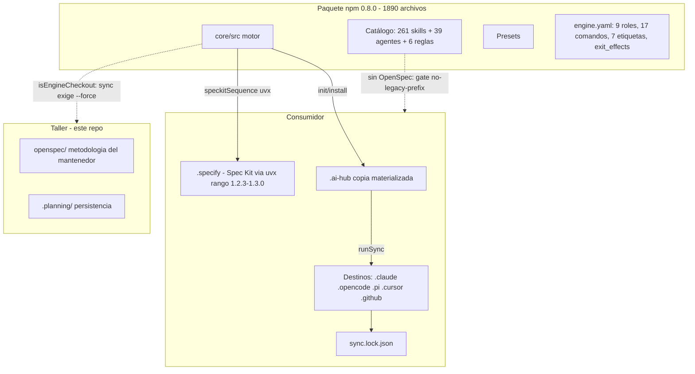
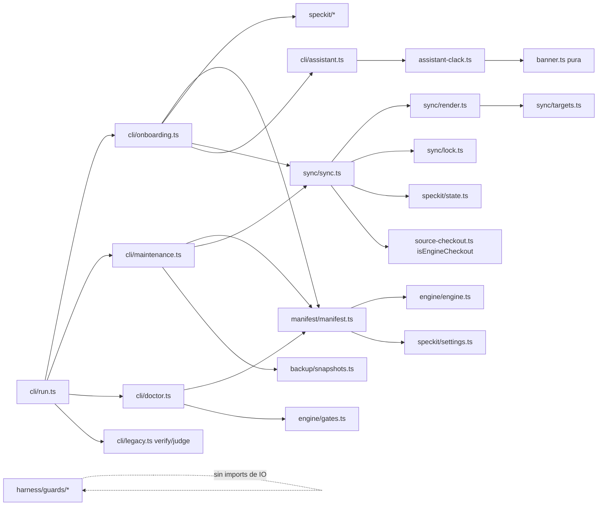
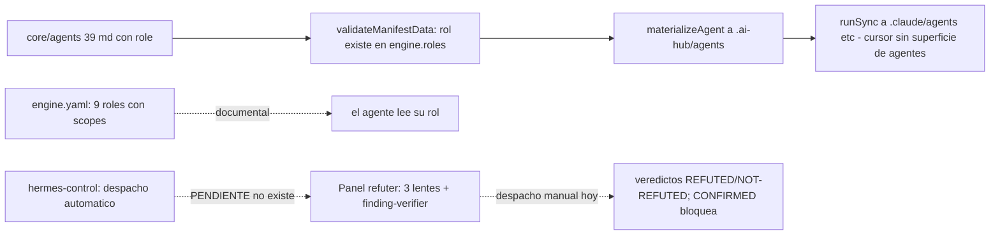
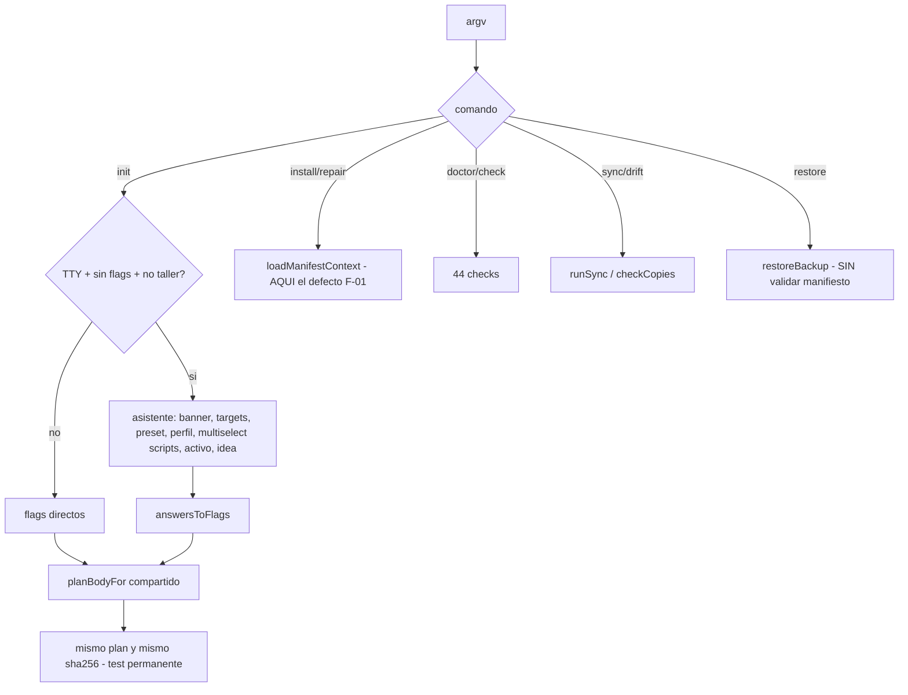
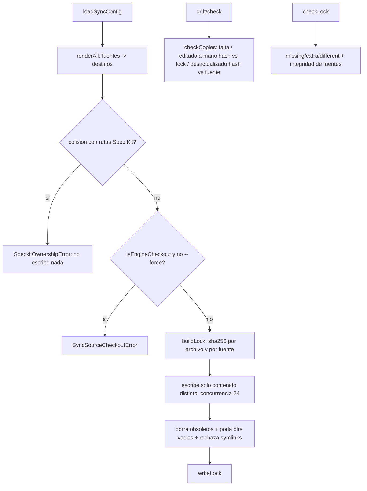
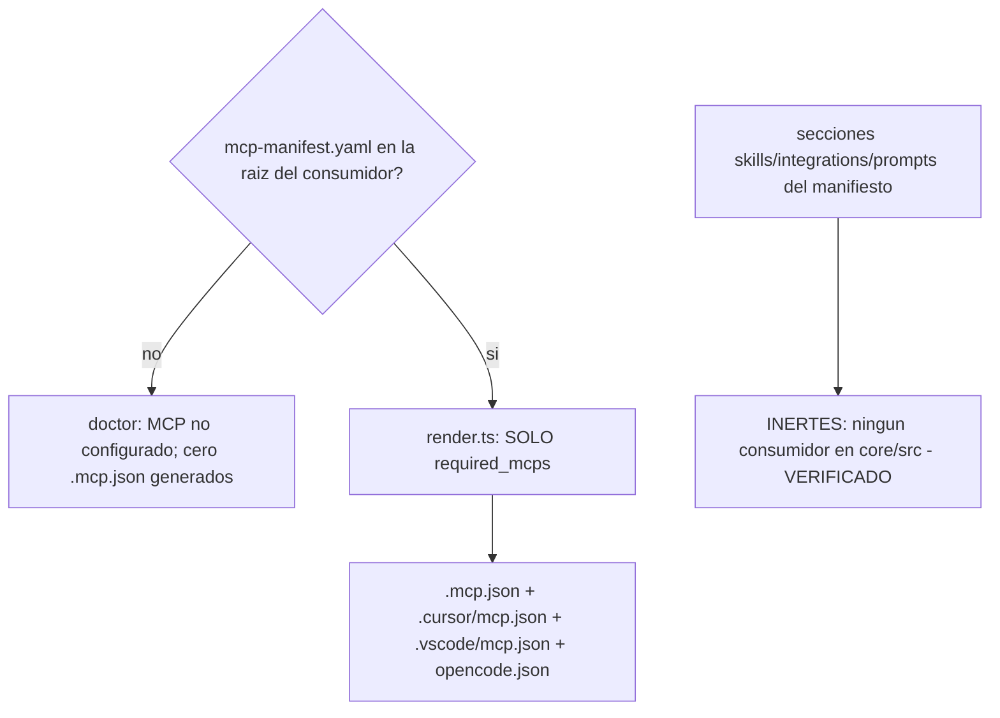
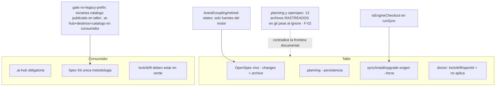

# AI-HUB — Auditoría técnica integral (30/10/2026)

**Alcance:** lectura estática completa del taller + ejecución de validaciones existentes (build, typecheck, suite unit/integration, manifest:check, doctor). Sin escrituras en el repo, sin sync/install/init/purge, sin git mutante, sin secretos. Cada hallazgo lleva su clase: **VERIFICADO** (evidencia directa) / **INFERIDO** (conclusión sobre varias evidencias) / **HIPÓTESIS** / **NO VERIFICADO**.

---

## 1. Resumen ejecutivo

AI-Hub es hoy un **motor de instalación y sincronización sólido y medido**, con una frontera taller/consumidor aplicada por código (no solo por documentos), sellos y locks SHA-256 reales, gates de marca/acoplamiento/legado que escanean de verdad, y una TUI cuya paridad de hash con los flags está probada por construcción. La suite completa está en verde (358 tests, 2 timeouts de I/O reintentados en aislamiento y confirmados).

El sistema tiene **tres verdades que mandan sobre cualquier lectura superficial**:

1. **La autonomía no está automatizada.** `hermes-control` no existe: hay tabla `exit_effects` (engine.yaml:250-265), un adaptador puro `preflightForRunner` (hermes.ts) y 25 diagramas conceptuales. Las etiquetas `ai::*` se mueven a mano. Esto no es un defecto: es la mitad del producto aún por construir.
2. **El camino de recuperación tiene un agujero real (F-01).** `install`/`repair` validan la existencia de los activos de `.ai-hub/` **antes** de materializarlos: borrar una skill fuente deja el arnés sin autorreparación. El test de repair cubre otra cosa (un destino generado), así que la suite no lo ve.
3. **La frontera documental y la frontera git no coinciden (F-02).** `.planning/` y `openspec/` están en `.gitignore`, pero **13 archivos de esas rutas están rastreados y en GitHub** (incluidos `memory.jsonl` y `findings.md`), porque el ignore no aplica a lo ya versionado.

No encontré **ningún P0**: sin vulnerabilidades críticas, sin corrupción de datos, sin secretos vivos en el repo.

---

## 2. Estado del repositorio (FASE 0) — VERIFICADO

| Aspecto | Valor medido |
|---|---|
| Rama / remoto | `main` → `origin/main` (github.com/dsalazardev/ai-hub), sin tags |
| Último commit | `402a954` feat(speckit): conjunto elegible, py activo y banner (0.8.0) |
| Árbol | Solo `.planning/current.md` modificado (cierre de sesión de este mismo día; cambio del propietario, protegido) |
| Versiones | Node v24.18.0 · npm 12.1.0 · uv 0.13.6 · Python **3.15.1** (la línea base dice 3.14 y uv 0.12: corrección menor) |
| Paquete | `@dsalazardev/ai-hub-cli` **0.8.0** (sin publicar en npm; prepublishOnly = build + manifest + test) |
| OpenSpec | `changes: []` — **script-choice ya está archivado** (la línea base lo dice "pendiente de archivar": corrección) |
| Git del PATH | Roto (WSL); todas las consultas con `C:\Program Files\Git\bin\git.exe` |

**F-02 (VERIFICADO, git ls-files):** rastreados pese al ignore — `.planning/`: context-next.md, current.md, findings.md, history.md, memory.jsonl, review_arch/review_tests (2), rsc-inventory, state.json (9+). `openspec/`: los 4 archivos de `changes/archive/2026-10-24-add-agents-md/`.

---

## 3. Inventario completo y clasificación de carpetas raíz (FASE 1)

El tarball (`npm pack --dry-run`, VERIFICADO: **1.890 archivos**) contiene solo: `skills` 1.641 · `dist` 126 · `presets` 67 · `agents` 39 · `engine` 4 · `rules` 4 · `schema` 4 · LICENSE/manifest.json/NOTICE.md/package.json/README.md. **Ninguna carpeta raíz del taller viaja** salvo las homólogas dentro de `core/`.

| Carpeta | Archivos | Clasificación | Consumidor / evidencia |
|---|---|---|---|
| `core/` | motor completo | **Activa (producto)** | src: cli 18, harness 13, speckit 8, sync 5, manifest 5, presets 4, engine 2, backup 1, bin 1 + 6 sueltos; 29 tests |
| `rules/` | 5 | **Activa (taller)** | `manifest.yaml rules.source: rules`; las 4 rúbricas son **byte-idénticas** a `core/rules/` (hashes comparados) y `pack.test.ts` exige esa igualdad |
| `harness/run-all.sh` | 1 | **Activa (taller)** | Ejecutado por `cmdVerify` (cli/legacy.ts:6-9): manifest:check + doctor |
| `orchestrator/` | 3 | **Activa (taller, documental)** | Roles derivados del orquestador (AGENTS.md §4); PROMPT.md arranca con `ai-hub context` |
| `documentation/` | 31 | **Diseño conceptual (no implementado)** | 25 .mmd del plano de control (hermes, estados issue/job, cinco planos) + Lucidchart + docx. Describe el sistema **objetivo**, no el actual |
| `archive/upstream/` | 16 | **Residual intencional (referencia histórica)** | Material del upstream ai-hub/rsc; fuera del tarball |
| `bootstrap/` | 2 | **Residual con referencia rota (F-03)** | `gitlab-auth/SKILL.md:43` exige `.ai-hub/bootstrap/load-env.sh`; **nada en core lo materializa** (glob `core/**/bootstrap/**` = 0) |
| `prompts/` | 2 | **Residual** | Solo referenciados por la sección inerte `prompts:` de mcp-manifest.yaml |
| `mcp-local/` | 1 | **Herramienta local del taller** | setup-playwright.sh; sin consumidor en el motor |
| `agents/` | **0** | **Residual vacía** | Ninguna referencia |
| `.github/workflows/ai-hub.yml` | 1 | **CI activa** | ubuntu: build + suite + manifest:check + doctor + smoke real (init/doctor/drift/check-lock con uvx) |
| `.specify/` | 38 | **Residuo local de dogfooding** | init-options: specify **1.2.1.dev0**, integration pi, script py — anterior al rango soportado actual; gitignoreado, doctor lo ignora en el taller |
| `.claude/.opencode/.pi` | 12-13 c/u | **Destinos dogfood + config local** | Gitignoreados; referenciados por el lock del taller |
| `.backups/` | 6 | **Snapshot local** (26/10, init) | Mecanismo legítimo de snapshots; gitignoreado |
| `sync.lock.json` (raíz) | 4.665 entradas / 1.118 fuentes | **Residuo de dogfooding, inerte** | Versionado; doctor del taller declara lock/drift "no aplica" (doctor.ts:333-335). Rompe la intuición de la frontera pero no la frontera ejecutada |
| `manifest.yaml` (raíz) | — | **Activo; `catalog.version: 0.6.0`** | Último sync --force del taller fue en 0.6.0; coherente con la regla "sync no escribe en el taller sin --force" |
| `.env.example` | — | **Evaluar (F-14)** | Solo nombres + `CHANGEME`; host GitLab de la marca anterior |
| `NOTICE.md` (raíz) | — | **Desactualizado (F-07)** | Cita `@onna/ai-hub-cli`; el NOTICE publicado correcto es `core/NOTICE.md` (sí declara herencia rsc-harness) |

---

## 4. Arquitectura real (FASE 2) — reconstruida desde la implementación

### 4.1 Capas verificadas

```
npx @dsalazardev/ai-hub-cli
  └─ bin/ai-hub.js → cli/run.ts (18 comandos + verify/judge legacy)
       ├─ onboarding.ts  init/install/repair + TUI (assistant, assistant-clack, banner, preprompt)
       ├─ maintenance.ts list/add/uninstall/backups/restore/purge/upgrade
       ├─ doctor.ts + engine/gates.ts (44 checks, escáneres reales)
       ├─ sync/ (config → render → lock) + sync/targets.ts (tabla declarativa)
       ├─ manifest/ (readManifestFile → validateManifestData: ajv + speckit + ACTIVOS)
       ├─ speckit/ (settings, commands, state, doctor, seal, shell)
       └─ harness/ (guards puros + adapters; worktree/reaper; memory state/ledger)
```

### Diagrama 1 — Arquitectura general



### Diagrama 2 — Dependencias entre módulos (imports reales)



Sin dependencias circulares detectadas en las rutas leídas; `speckit/state.ts` es usado por `sync` (dirección correcta: el sync conoce al dueño Spec Kit, no al revés). `banner.ts` no importa nada (pura, VERIFICADO en 0.8.0).

### Diagrama 3 — Inicialización del motor

```mermaid
sequenceDiagram
  participant U as Usuario
  participant B as bin/ai-hub.js
  participant R as cli/run.ts
  participant P as paths.ts resolveAiHubDir
  U->>B: ai-hub <cmd> [flags]
  B->>R: parseArgs + createContext
  R->>P: AI_HUB_DIR / .ai-hubrc.json / .ai-hub / ai-hub / manifest.yaml ancestro
  P-->>R: {dir, source}
  R->>R: dispatch COMMANDS[cmd] (o LEGACY verify/judge)
  Note over R: init sin flags + TTY + no engine checkout -> asistente clack; si no, flujo de flags byte a byte
```

### Diagrama 4 — Ciclo de vida de agentes y roles



**Distinción clave (VERIFICADO):** los permisos de rol se validan estructuralmente (rol desconocido = manifiesto inválido), pero el cumplimiento del scope es **documental**: ningún mecanismo impide mecánicamente que un agente edite fuera de su rol. Los guards (danger/trunk/branch/ship) sí son mecánicos, pero en `guardMode: shadow` por defecto solo registran.

### Diagrama 5 — Flujo de comandos CLI



### Diagrama 6 — Sincronización con lock y hashes



### Diagrama 7 — Instalación y bootstrap

```mermaid
flowchart TD
  A[npx init] --> B[deteccion stack -> preset]
  B --> C[seleccion full/preset-only/custom]
  C --> D[speckitBlock + assertScriptCoherence: activo dentro del conjunto o exit 2]
  D --> E[preflight Spec Kit fail-closed: uvx, bash/python segun activo]
  E --> F[createBackup]
  F --> G[materializeSelection]
  G --> H[installSpeckit: un specify init por miembro, activo al final]
  H --> I[runSync + writeInventory + .gitignore]
  Note over H: specify-cli 1.2.5 con init py arrastra powershell propio - carga de specify, no del conjunto
```

### Diagrama 8 — Spec Kit de extremo a extremo

```mermaid
flowchart LR
  A[idea: backlog/seed.md + pre-prompt] --> B[/speckit.constitution]
  B --> C[assess x5: GO/KILL/NEEDS_CLARIFICATION]
  C --> D[specify/clarify/plan/tasks]
  D --> E[sello SHA-256 de spec+plan+tasks - seal.ts VERIFICADO]
  E --> F{aprobacion humana ai::spec-ready}
  F --> G[implement -> analyze -> review]
  G --> H[panel refuter - manual hoy]
  H --> I[converge: CONVERGED/NEEDS_WORK]
  I --> J[VERIFIED -> ai::done]
  K[hermes-control: aplica exit_effects y revalida sello] -.PENDIENTE: hoy las etiquetas se mueven a mano.-> F
  K -.PENDIENTE.-> I
```

### Diagrama 9 — Integración MCP



### Diagrama 10 — La frontera taller/instalación



---

## 5. Análisis del CORE (FASE 3 y 8)

| Pregunta de la auditoría | Resultado | Evidencia |
|---|---|---|
| ¿`runPreflight` puro? | **SÍ — VERIFICADO** | preflight.ts importa solo branch/danger/ship/trunk/types; en `harness/guards` solo `adapters/context.ts` (builder de contexto, permitido) importa fs/child_process |
| ¿Sello == vector publicado? | **SÍ — VERIFICADO** | Recomputado con SHA-256 independiente (.NET): `35a81eb3…15b` idéntico a AGENTS.md §5; canonicalContent LF/sin BOM en seal.ts:16-19 |
| ¿Hash TUI == flags? | **SÍ — VERIFICADO** | `answersToFlags` y `parseArgs` convergen en `planBodyFor`; test permanente en assistant.test.ts; e2e 0.8.0: bare ≡ `--scripts sh,ps,py` = `5e069b92…c09b` |
| ¿Gate de marca barre todo lo publicado? | **NO, por extensión — VERIFICADO** | brand.test.ts: TEXT_FILE = md/yaml/json; SCAN_TREES = core/skills, core/agents, rules. El único token upstream que escapa en TODO el catálogo es `scrub-engine.js:2` ("part of rsc-harness (MIT)") — atribución legal que core/NOTICE.md sanciona. Evaluación: la exclusión es **hoy benigna**; el agujero es real pero su contenido total es esa única línea (F-06) |
| ¿Validación ajv fail-closed? | **SÍ — VERIFICADO** | additionalProperty con nombre del campo; rol desconocido rechazado (manifest.ts:193-199); speckit validado antes del schema con mensajes explícitos; activo fuera del conjunto = exit 2 antes de escribir (assertScriptCoherence) |
| ¿Gate `engine:no-coupling` real? | **SÍ — VERIFICADO** | gates.ts:143-155 escanea core/src, core/engine, core/agents, core/skills/shared con términos de `coupling.json` (dolibarr, doligestion, onna-architecture); corre como test y como doctor check |
| Deuda de código | 0 `any`; 0 TODO/FIXME reales (mis 10 "matches" iniciales eran "todo" en español — falso positivo de método, corregido) | typecheck estricto verde |
| Observación estructural | `onboarding.ts` ≈1.100 líneas concentra init+install+repair+flags+plan | INFERIDO: es el módulo más cargado; candidato a división futura, no urgente |

**F-01 — Defecto de reparación, diagnóstico exacto (VERIFICADO):**
- `cmdRepair` = alias puro de `cmdInstall` (onboarding.ts:1054-1056).
- `cmdInstall` línea **953**: `loadManifestContext(ctx.root)` → `validateManifestData` → líneas **167-173** de manifest.ts: por cada skill publicada exige `.ai-hub/skills/<id>/SKILL.md`; si falta → `ManifestError` → return 1 en la línea 956. Lo mismo para agentes (180-201) y reglas (202-207).
- La materialización que restauraría el activo está en la línea **1005** (`materializeSelection`): **después** del punto de aborto.
- **Causa raíz:** la validación de existencia de activos (invariante POST-materialización) está acoplada a la CARGA del manifiesto (paso PRE-materialización), y `repair` no es un camino de recuperación propio sino un alias del camino bloqueado.
- **Corrección a la línea base §2.5.1:** `restore` **no** aborta — `cmdRestore` (maintenance.ts:259-282) nunca carga el manifiesto; restaura el snapshot directamente. Y el doctor no deja "sin salida" informativa: reporta un check `manifest` en rojo que **nombra la skill ausente** (doctor.ts:121-123), aunque salta el resto de checks.
- **Hueco de test:** `cli.test.ts:436` ("repair restores a deleted generated file") borra `.claude/agents/spec-author.md` (destino), no una fuente de `.ai-hub/skills`. El defecto no tiene test.
- **Arreglo propuesto (sin ejecutar):** separar `validateManifestData` en validación de carga (schema + roles + speckit, siempre fail-closed) y validación de activos (existencia/frontmatter). `install`/`repair` cargan en modo tolerante-a-activos-ausentes, materializan y **revalidan** después; ids desconocidos siguen fallando. Riesgo: bajo si la revalidación post queda en el mismo comando. Complejidad: S-M. Aceptación: borrar `.ai-hub/skills/<id>` → `repair` exit 0 y skill restaurada; borrar y adulterar `skills.publish` con un id inexistente → sigue exit 1/2.

---

## 6. Agentes y skills (FASE 4) — VERIFICADO

- 39 agentes publicados; `role` validado contra los 9 roles del engine; cursor sin superficie de agentes (`agents: null`, targets.ts:70).
- Los 4 cuerpos adversariales conservan el contrato: refuter-correctness leído íntegro — cuatro inputs exactos, prohibición de la defensa del builder, "blind first, compare second", bloque `json findings`, "zero findings con attack list es válido"; finding-verifier con CONFIRMED/REFUTED/UNPROVEN y "solo CONFIRMED bloquea".
- 272 skills en disco, 11 `runtime: false` (fuera del instalable, dentro del paquete); 261 publicadas; marca `origin: dsalazardev` exigida por brand.test.
- **F-03 (VERIFICADO, nuevo):** `core/skills/shared/gitlab-auth/SKILL.md:43` instruye `source .ai-hub/bootstrap/load-env.sh`, pero no existe `bootstrap/` en `core/` ni referencia de materialización en `core/src`. La skill publicada exige un activo que la fábrica no instala. Impacto: el flujo documentado de credenciales GitLab falla en un consumidor limpio (el script solo existe en la raíz del taller y en la v1 vendorizada de doligestion). Severidad P2; arreglo: materializar `bootstrap/` como activo del catálogo o reescribir la skill para cargar `.ai-hub/.env` sin script. Es además un **tipo de defecto generalizable**: no existe test que barra las rutas `.ai-hub/**` referenciadas por las skills y compruebe que se materializan.

---

## 7. Orquestación: lo ejecutado vs lo documentado (FASE 5) — el diagnóstico central

| Elemento | Estado | Evidencia |
|---|---|---|
| Tabla `exit_effects` (14 estados → efecto en etiqueta) | **Documentada en engine.yaml; no ejecutada por nadie** | engine.yaml:250-265; doctor valida consistencia, no ejecución |
| Etiquetas `ai::*` | **Manuales** | No existe código que las lea o escriba (0 referencias de control en core/src) |
| Guards danger/trunk/branch/ship | **Implementados y testeados** | danger.ts: 13 reglas, stripQuoted + expansión `bash -c`, preset solo endurece; `guardMode: shadow` por defecto — registran, no bloquean |
| `preflightForRunner` (adapter hermes) | **Implementado, puro, sin runner que lo invoque** | hermes.ts:15-32; "authoritative entrypoint" para un runner futuro |
| Reaper de worktrees | Implementado + test (reaper.test.ts) | Conservador |
| Ledger `.planning` (state + JSONL) | Implementado + tests (state/ledger.test.ts); "no aplica en instalación" | Solo taller |
| Panel refuter | Cuerpos publicados; **despacho manual** | Sin orquestador que lo llame |
| Puerta humana del sello | `featureSeal` implementado y vector verificado; **publisher→aprobación→revalidación sin automatizar** | seal.ts + AGENTS.md §5 |
| `hermes-control` | **NO EXISTE** | Solo documentación conceptual (documentation/architecture/mermaid, 25 diagramas) |

**Forma mínima viable recomendada (P4, diseño, no implementación):** empezar como **módulo del CLI ejecutado por un job de GitLab** (`ai-hub control tick` o similar), no como servicio: consume `exit_effects` + `featureSeal` + labels de engine.yaml, revalida hash antes de mover etiquetas, propone KILL/INVALID a humano. Un servicio permanente añadiría operación sin necesidad actual. La secuencia correcta es: primero F-01 y gobernanza git, luego este plano de control — construirlo sobre la base actual es seguro; construirlo antes de limpiar la frontera documental heredaría ambigüedad.

---

## 8. CLI, TUI y bootstrap (FASE 6) — VERIFICADO

- 18 comandos registrados (run.ts:127-146) + `verify`/`judge` legacy (150-153). `judge` es stub declarado ("no implementado").
- TUI: gate TTY estricto, banner puro, multiselect del conjunto + select del activo, idea opcional; paridad de hash probada; salida pipeada byte a byte idéntica (tres sondas en 0.8.0).
- **F-12 (VERIFICADO):** `cmdVerify` ejecuta `spawnSync('bash', …)` directo (legacy.ts:10) — no reutiliza el resolvedor autónomo de shell; en esta máquina (bash del PATH = lanzador WSL roto) fallaría. Legacy, baja severidad.
- **F-11 (VERIFICADO):** el doctor imprime `[OK] full: full desactualizado: 0 activos nuevos; ejecuta upgrade` — mensaje contradictorio cuando no hay nada que actualizar (doctor.ts:~210). Cosmético.
- Instalación medida ~60 s; preflight fail-closed; resolución Git Bash fuera del PATH funciona (doctor e2e: `C:\Program Files\Git\bin\bash.exe`).
- Experiencia `repair` rota para el accidente más plausible (F-01) — es el único punto de DX realmente defectuoso encontrado en el flujo principal.

---

## 9. Manifiestos y sincronización (FASE 7) — VERIFICADO

- Tres manifiestos con dueños claros: `manifest.yaml` de proyecto (taller o consumidor, YAML) · `.ai-hub/manifest.json` (inventario generado; doctor detecta desactualización, cli.test.ts:426-434) · `core/manifest.json` (inventario del motor; `manifest:check` verde).
- Lock v2: sha256 por archivo y por fuente; `checkCopies` distingue **falta / editado a mano (hash≠lock) / desactualizado (hash=fuente vieja)** — la copia editada a mano se detecta y se reporta con su fuente (sync.ts:135-154). `checkLockIntegrity` verifica hashes de las fuentes (177-196): adulterar `.ai-hub/` queda detectado.
- Escrituras solo si el contenido difiere; obsoletos borrados con poda de directorios; symlinks rechazados; colisión Spec Kit fail-closed antes de escribir nada.
- Punto menor (INFERIDO): no hay escritura transaccional — un corte a mitad de sync deja lock viejo + archivos nuevos parciales, pero drift/lock lo hacen **detectable**, no silencioso. Riesgo aceptable, documentado aquí por completitud.
- Lock del taller (4.665/1.118): residuo de dogfooding inerte; no rompe la frontera ejecutada, sí la intuición (clasificado, F-13).

---

## 10. Integraciones y MCP (FASE 8) — VERIFICADO

- Tabla declarativa de 5 targets; añadir un tool = una fila + un id (targets.ts:33-37). Spec Kit llega a exactamente 4 integraciones (claude `-`, opencode `.`, pi `.`, cursor-agent `-`); copilot `speckit: null` recibe agentes/reglas solamente.
- MCP: fuente explícita del consumidor; sin `mcp-manifest.yaml` → "MCP: no configurado" y cero archivos generados. **Solo `required_mcps` se consume** (render.ts:281-284).
- **F-10 (VERIFICADO):** el `mcp-manifest.yaml` del taller conserva vocabulario y referencias de la era anterior: skills `onna-architecture-bff` y `angular-developer` (ausentes del catálogo actual), endpoint onnadigital, y `prompts:` a `.ai-hub/prompts/` que tampoco se materializan. Es configuración **inerte** (no rompe nada) pero engañosa.

---

## 11. Spec Kit y frontera con OpenSpec (FASE 9) — VERIFICADO

- Rango flotante `>=1.2.3 <1.3.0` (engine.yaml:287-293); uvx, sin `uv tool install`, sin fecha; extensiones assess/bug 1.0.1; conjunto sh/ps/py elegible con activo coherente (fail-closed) y compañero powershell de specify-cli 1.2.5 documentado en spec principal tras el archivo de script-choice.
- OpenSpec **vivo en el taller** (7 specs principales: dev-cli 37, agent-guardrails 18, preset-system 14, spec-kit-pipeline 13, interactive-onboarding 7, harness-memory 5, backlog-seed 3) y **ausente del consumidor** por el gate no-legacy-prefix que escanea en ambos ambientes con reglas distintas (gates.ts:88-104). `openspec validate --all`: 7 passed, 0 failed (post-archivo).
- Pasos manuales que rompen la continuidad del pipeline: etiquetas `ai::*`, despacho del panel, publisher del sello (todo converge en hermes-control, §7).

---

## 12. Calidad del código y deuda (FASE 10)

Deuda clasificada: **arquitectónica** (F-01 acoplamiento carga/validación de activos); **de testing** (caso repair sin test; sin barrido de rutas `.ai-hub/**` referenciadas por skills); **de documentación** (F-05 preset-system, F-07 NOTICE raíz, F-08 rules/core.md, F-09 IDEA.md, F-10 mcp-manifest); **operativa** (F-02 archivos de taller rastreados; F-13 residuos clasificados); **de compatibilidad** (F-12 verify con bash crudo); **evolutiva** (hermes-control, publisher, doligestion). Sin deuda de tipado (0 any) ni placeholders reales.

---

## 13. Seguridad (FASE 11)

| Hallazgo | Vector / escenario | Evaluación | Severidad |
|---|---|---|---|
| Guards en `shadow` por defecto | Un agente ejecuta `git push --force`: se registra, no se bloquea | Diseño deliberado (opt-in enforce); riesgo real si el consumidor cree estar protegido por defecto | Media-baja; mitigar con documentación visible del modo y recomendación de enforce en CI |
| Prompt injection desde contenido del repo | Un archivo del repo instruye al agente fuera de su rol | **No hay defensa mecánica** (inherente a la clase de producto); mitigaciones presentes: gates de marca/legado sobre fuentes publicadas, lock con hashes de fuentes (adulteración de `.ai-hub/` detectada), panel refuter, puerta humana | Media (INFERIDO); aceptar y documentar como riesgo de clase |
| Secretos | `.env.example` solo nombres + CHANGEME; `.env` ignorado (`*.env`); `GITLAB_TOKEN` por entorno | Higiene correcta; el host de la marca anterior es cosmético (F-14) | Baja |
| Ejecución externa | specify-cli vía uvx en rango acotado; flags validados por whitelist (sh/ps/py); probes `--version` | Superficie acotada; sin shell interpolado con entrada libre en las rutas leídas | Baja |
| Suplencia de cadena | 3 deps runtime (ajv, yaml, @clack/prompts) + 3 dev; lockfile versionado; `npm ci` en CI | Mínima y sana | Baja |

**Sin P0 de seguridad.**

---

## 14. Testing (FASE 12) — ejecutado en esta auditoría

| Comando | Resultado | Nota |
|---|---|---|
| `npm run build` | exit 0 | tsc |
| `npm run typecheck` | exit 0 | estricto |
| `vitest --project unit` | **221 passed + 2 failed + 1 skipped (224)** → reintento aislado de los 2: **verde en 6,4 s** | Los 2 fallos fueron **timeouts de 10 s sin AssertionError** (coupling + retired-states) bajo saturación de I/O de OneDrive mientras yo escaneaba en paralelo. **No hay regresión**; queda constancia del método exigido |
| `vitest --project integration` | **134 passed (134)**, 415 s | Incluye speckit-real con uvx |
| `npm run manifest:check` | `[OK] manifest.json actualizado` | |
| `doctor` (taller) | **44 checks, "Resultado: sano"**, exit 0, 8,2 s | lock/drift/speckit "no aplica": correcto |
| `version` | 558 ms | arranque CLI |

**Lo que la suite NO demuestra (VERIFICADO como ausencias):** (1) el caso F-01 (fuente de `.ai-hub/` borrada); (2) que toda ruta `.ai-hub/**` citada por una skill se materialice (F-03 habría sido cazado por ese test); (3) comportamiento de la TUI con TTY real (pendiente manual); (4) rutas git en Windows (tests git se auto-omiten sin git ejecutable); (5) hermes-control (no existe); (6) rendimiento sostenido bajo OneDrive (los 2 timeouts lo evidencian).

---

## 15. Documentación (FASE 13) — divergencias encontradas

- **F-05:** preset-system cita 174 skills y 4.642/4.657 destinos (líneas 138, 148, 182, 187) — pre-0.5.0. Conocido, confirmado.
- **F-07 (nuevo):** NOTICE.md raíz con `@onna/ai-hub-cli`; el correcto y publicado es `core/NOTICE.md`.
- **F-08 (nuevo):** AGENTS.md §1 cita `rules/core.md`; el archivo real es `rules/engine-core.md`.
- **F-09 (nuevo):** IDEA.md:45 cita `ai-hub/architecture/`; la ruta real es `documentation/architecture/`.
- **F-10:** mcp-manifest del taller con skills inexistentes y secciones inertes.
- **F-02:** la afirmación "openspec/ y .planning/ viven solo en esta máquina" es falsa para 13 archivos rastreados.
- Fuerte al contrario: README/CHANGELOG de 0.8.0 están verificados por `release.test.ts`; cifras MEASURED-driven sin duplicación manual.

---

## 16. Rendimiento y escalabilidad (FASE 14) — medido, no hipotético

- Arranque CLI 558 ms; doctor del taller 8,2 s; init completo ~60 s (medido previamente, README); sync escribe solo diferencias con `mapLimit(24)`; lock de 6.853 destinos se verifica por hashes con la misma concurrencia.
- Cuello real: **I/O de OneDrive** (2 timeouts de tests bajo carga paralela en esta misma auditoría). No encontré problema algorítmico: renderAll + buildLock leen cada fuente una vez; checkCopies cada destino una vez. Escalabilidad del catálogo lineal en archivos; nada que justifique paralelización nueva sin medir antes.

---

## 17. Matriz de hallazgos priorizados (FASE 16)

| ID | Título | Pri | Categoría | Verificación | Causa raíz / impacto | Solución (complejidad) | Criterio de aceptación |
|---|---|---|---|---|---|---|---|
| F-01 | install/repair abortan si falta un activo de `.ai-hub/` | **P1** | Arquitectura/recuperación | VERIFICADO (código + ausencia de test) | Existencia de activos validada en la carga (manifest.ts:167-173) antes de materializar (onboarding.ts:953 vs 1005); repair es alias | Separar validación de carga y de activos; revalidar post-materialización (S-M) | Borrada una skill fuente → repair la restaura, exit 0; id desconocido sigue fallando; test nuevo |
| F-02 | 13 archivos de `.planning/`/`openspec/` rastreados pese al ignore | **P2** | Gobernanza/frontera | VERIFICADO (git ls-files) | Ignore no aplica a lo ya versionado; estado operativo y ledger viajan a GitHub y a todo clone | Decidir: `git rm --cached` + purga puntual, o aceptar y corregir AGENTS.md (XS) | `git ls-files` vacío en esas rutas o documentación corregida |
| F-03 | `gitlab-auth` exige `.ai-hub/bootstrap/load-env.sh` no materializado | **P2** | Catálogo/DX | VERIFICADO (glob + grep) | Activo huérfano fuera del catálogo; flujo GitLab roto en consumidor limpio | Materializar bootstrap como activo o reescribir la skill (XS-S) + test de rutas referenciadas | Consumidor limpio ejecuta el paso de la skill sin error de ruta |
| F-04 | hermes-control inexistente (etiquetas y panel manuales) | **P4** | Evolutiva (mayor hueco de producto) | VERIFICADO | Plano de control solo diseñado | Módulo CLI + job GitLab que consuma exit_effects + seal + labels (L, por fases) | Un issue recorre estados sin intervención manual salvo puertas humanas |
| F-05 | Drift de cifras en preset-system | P3 | Documentación | VERIFICADO | Escenarios pre-0.5.0 | Actualizar a 261/6.833/6.853 etc. (XS) | validate verde y cifras == MEASURED |
| F-06 | Gate de marca no barre `.js` | P3 | Seguridad de marca | VERIFICADO | TEXT_FILE limitado; contenido actual benigno (1 atribución MIT) | Documentar exclusión o barrer código con allowlist de atribución (XS) | Decisión registrada; sin tokens operativos fuera del gate |
| F-07 | NOTICE.md raíz con nombre de paquete viejo | P3 | Documentación/legal | VERIFICADO | Duplicado desincronizado de core/NOTICE.md | Sincronizar o referenciar (XS) | Marca correcta en ambos |
| F-08 | AGENTS.md cita `rules/core.md` inexistente | P3 | Documentación | VERIFICADO | Renombrado a engine-core.md | Corregir referencia (XS) | Ruta real citada |
| F-09 | IDEA.md cita `ai-hub/architecture/` | P3 | Documentación | VERIFICADO | Ruta movida a documentation/ | Corregir (XS) | Ruta real citada |
| F-10 | mcp-manifest del taller con skills inexistentes y secciones inertes | P3 | Configuración | VERIFICADO | Manifiesto de la era onna; solo required_mcps se consume | Limpiar skills/prompts o eliminar secciones inertes (XS) | Sin referencias a ids inexistentes |
| F-11 | Mensaje `full desactualizado` con [OK] y 0 activos nuevos | P3 | UX | VERIFICADO (salida doctor) | Rama de texto compartida | Texto distinto cuando no hay novedad (XS) | Mensaje coherente |
| F-12 | `cmdVerify` usa bash crudo del PATH | P3 | Compatibilidad | VERIFICADO (legacy.ts:10) | No reutiliza shell-resolution | Reusar probeShell/resolver (XS-S) | verify funciona con bash de WSL roto |
| F-13 | Residuos clasificados: `agents/` vacía, `prompts/` sin consumidor, `.specify/` de specify 1.2.1.dev0, lock del taller 4.665, catalog.version 0.6.0 | P3 | Higiene del taller | VERIFICADO | Capas de dogfooding histórico | Borrar o archivar localmente (XS); sin tocar desde esta auditoría | Raíz sin residuos ambiguos |
| F-14 | `.env.example` con host de la marca anterior | P3 | Documentación/secretos | VERIFICADO | Herencia onna; valores ya CHANGEME | Actualizar host/ejemplo o mantener con nota (XS) | Ejemplo coherente con la marca |
| F-15 | Automatización publisher→aprobación→revalidación del sello ausente | P4 | Evolutiva | VERIFICADO | Mismo hueco que F-04 (parte de hermes) | Incluir en el plano de control (con F-04) | Revalidación fail-closed antes de ai::in-dev |
| F-16 | Doligestion en v1 vendorizada sin migrar | P4 | Evolutiva/operativa | NO VERIFICADO (fuera del directorio de trabajo; según línea base) | Primer consumidor sin manifest v2 | Migración asistida (M) | doligestion con doctor/drift en verde |
| F-17 | Tests ausentes: caso F-01 y barrido de rutas `.ai-hub/**` referenciadas por skills | P2 | Testing | VERIFICADO | Ningún test cubre esas clases de defecto | Dos suites pequeñas (S) | Ambos defectos habrían fallado en CI |

**Sin P0.** F-04/F-15/F-16 son capacidad nueva, no defectos; no se inflaron en la matriz.

---

## 18. Evaluación de madurez (FASE 17) — 0-5 con evidencia

| Área | Nota | Qué falta para el siguiente nivel |
|---|---|---|
| Arquitectura | **4** | Capas y frontera aplicadas por código; para 5: plano de control real |
| Calidad de código | **4** | 0 any, módulos claros; onboarding.ts muy grande |
| Motor core | **4** | Gates reales; para 5: cerrar F-01 |
| Agentes | **4** | Contratos verificados; scopes documentales, no mecánicos |
| Skills | **4** | Marca y medidas; para 5: test de rutas referenciadas (F-03) |
| **Orquestación** | **1** | Hay tabla de estados y guards; **la autonomía no está automatizada** (hermes-control inexistente) |
| CLI y bootstrap | **3** | Sólido y medido, pero el camino de recuperación está roto (F-01): no se puede llamar validado |
| Integraciones | **4** | Declarativas y completas; mcp-manifest del taller con inercia |
| Sincronización | **4** | Hashes y drift verificados de verdad |
| Gobernanza | **3** | Sello probado; publisher sin automatizar; F-02 contradice la frontera documental |
| Seguridad | **3** | Sin críticos; guards en shadow por defecto; prompt injection como riesgo de clase sin defensa mecánica |
| Testing | **4** | 358 tests con e2e real; dos clases de hueco nombradas (F-17) |
| Documentación | **3** | AGENTS.md fuerte pero con 4 divergencias nuevas + preset-system |
| Rendimiento | **4** | Medido; cuello = OneDrive, no algoritmo |
| Experiencia de desarrollador | **4** | npx → doctor guiado; F-01/F-03 empañan la recuperación |
| Portabilidad | **3** | CI Linux + Windows real con resolvedor de shell; verify con bash crudo; symlinks sin cubrir en Windows |

El promedio no tapa lo esencial: **orquestación 1** es la distancia entre "arnés instalado" y "fábrica autónoma".

---

## 19. Arquitectura objetivo propuesta (FASE 18) — solo diseño

1. **Recuperación por capas de validación (cierra F-01, primero):** `loadManifestContext({ assets: 'strict' | 'tolerant' })`. Carga siempre valida schema/roles/speckit (fail-closed); existencia de activos solo en modo strict (doctor, list, sync) y **post-materialización** en install/repair. Compatibilidad: manifiestos intactos; contratos de error para ids desconocidos intactos. Pruebas: las dos direcciones del gate (borrado restaurable / id inválido sigue fallando).
2. **Catálogo con activos de soporte declarados (cierra F-03):** las rutas `.ai-hub/**` que una skill referencia deben ser activos materializables del catálogo (o la skill se reescribe para no necesitarlas). Añadir un gate estático: barrido de `\.ai-hub/[\w./-]+` en skills publicadas → cada ruta debe existir en el plan de materialización.
3. **Plano de control mínimo (F-04/F-15):** módulo `control` en el CLI, invocable por job de GitLab: lee issues + etiquetas, ejecuta el comando Spec Kit del estado actual, aplica `exit_effects`, revalida el sello antes de `ai::in-dev`, propone cierres KILL/INVALID a humano. Sin servicio nuevo; estado en el issue, no en una base de datos. Fases: (a) lectura y dry-run de decisiones, (b) aplicación de etiquetas, (c) despacho del panel.
4. **Frontera documental = frontera git (F-02):** decisión explícita y única: o se des-rastrean los 13 archivos, o AGENTS.md deja de afirmar que viven solo localmente.
5. **Limpieza documental agrupada (F-05…F-14):** un solo change de higiene, sin lógica.

**Orden de dependencias:** 1 y 4 primero (base correcta) → 2 y 5 (higiene verificable) → 3 (construir autonomía sobre base limpia).

---

## 20. Roadmap priorizado (FASE 19)

| Etapa | Objetivo | Contenido (IDs) | Tamaño | Criterio de fin |
|---|---|---|---|---|
| **A. Estabilización** | Recuperación y frontera reales | F-01 + su test; F-02 | S-M | repair restaura fuentes borradas; git y documentos cuentan la misma frontera |
| **B. Corrección arquitectónica** | Catálogo auto-contenido | F-03 + gate de rutas referenciadas (F-17 parcial) | S | Ninguna skill referencia activos inexistentes |
| **C. Fiabilidad** | Sin mensajes/config engañosos | F-10, F-11, F-12, F-13, F-14 | XS-S | doctor coherente; verify usa el resolvedor; raíz clasificada limpia |
| **D. Seguridad y gobernanza** | Marca y documentos sincronizados | F-05, F-06, F-07, F-08, F-09 | XS | Cero divergencias doc/código conocidas |
| **E. Rendimiento y mantenibilidad** | Base para crecer | División de onboarding.ts; reintento documentado de timeouts de I/O | S-M | Suite estable bajo OneDrive |
| **F. Evolución funcional** | Fábrica autónoma | F-04+F-15 (fases a/b/c), F-16 migración doligestion | L | Issues operados sin etiquetas manuales; primer consumidor migrado |

---

## 21. Riesgos de intervención (qué no tocar sin resolver dependencias)

- **`validateManifestData`:** la comparten doctor/list/add/sync/install — el arreglo de F-01 debe ser quirúrgico o rompe el fail-closed que hoy protege al consumidor.
- **La frontera `isEngineCheckout` y los gates de legado/marca:** cualquier limpieza de carpetas raíz (`bootstrap/`, `prompts/`, `archive/`) debe verificar antes referencias (F-03 demuestra que una carpeta "residual" puede estar citada por una skill publicada).
- **`sync.lock.json` del taller y `catalog.version: 0.6.0`:** no "corregirlos" a mano; son estado de dogfooding, no drift de producto.
- **Cambios del propietario:** `.planning/current.md` modificado hoy (cierre de script-choice) — proteger, no revertir.
- **La TUI:** cualquier cambio en el paso de scripts exige re-correr la sonda de salida pipeada byte a byte.

---

## 22. Pendientes de inspección (declarados)

- **Doligestion:** fuera del directorio de trabajo; no inspeccionado (F-16 queda NO VERIFICADO).
- **TUI con TTY real:** pendiente manual del propietario (banner, multiselect, select del activo) antes de mover latest en npm.
- **`archive/upstream/` (16 archivos) y `documentation/lucidchart` (PDF/JSON):** inventariados, no auditados en contenido.
- **Registro npm:** no consultado; 0.7.0/0.8.0 sin publicar (según sesión previa).
- **Windows git-paths:** tests auto-omitidos por git roto del PATH; cobertura real de esas rutas sin verificar en esta máquina.

---

## 23. Conclusión técnica

El motor hace lo que promete y lo demuestra con evidencia: sellos que recomputan igual, locks que detectan la mano, gates que escanean, TUI que no altera un byte del flujo no interactivo, CI que instala de verdad. Las correcciones necesarias son **pocas y acotadas**: una validación mal ubicada (F-01), una frontera git descuadrada (F-02), un activo huérfano (F-03) y una capa de higiene documental. Lo grande no es un defecto sino una obra pendiente: **hermes-control es la diferencia entre un excelente instalador y una fábrica autónoma**, y debe construirse después de A-D, no antes.

---

## 24. CONTRASTE CON LA LÍNEA BASE — el mayor aporte

**Confirmado (con evidencia propia, no repetido):** catálogo 261+11/272, 39 agentes, 9 roles, 17 comandos, 7 etiquetas; 18 comandos CLI (+2 legacy); cifras MEASURED; suite 29 archivos/358 tests en verde; 0 any; sello == vector; preflight puro; paridad TUI/flags; frontera isEngineCheckout + "no aplica" del doctor; marca en las fuentes; 4 integraciones Spec Kit; panel refuter íntegro; tarball 1.890 sin carpetas del taller.

**Corregido:**
1. **script-choice ya está archivado** (`2026-10-30-script-choice`; `openspec list` vacío) — la línea base lo daba pendiente.
2. **Doctor = 44 checks**, no "~40".
3. **§2.5.1 es impreciso en dos puntos:** `restore` **no** aborta (no valida manifiesto), y el doctor **sí nombra** el activo ausente en un check rojo. El defecto real es install/repair, con línea exacta.
4. **"`.planning/` y `openspec/` viven solo en esta máquina" es falso** para 13 archivos rastreados (F-02).
5. Entorno: Python **3.15.1**, uv **0.13.6** (línea base: 3.14 / 0.12).

**Descubierto (nadie lo había nombrado):**
- **F-03:** la skill publicada `gitlab-auth` depende de `.ai-hub/bootstrap/load-env.sh`, un activo que la fábrica **no instala** — y falta la clase de test que cazaría esto (barrido de rutas referenciadas por skills).
- **F-07/F-08/F-09:** tres referencias documentales rotas nuevas (NOTICE raíz `@onna/ai-hub-cli`; `rules/core.md` inexistente en AGENTS.md; `ai-hub/architecture/` en IDEA.md).
- **F-10:** el `mcp-manifest.yaml` del taller declara skills inexistentes (`onna-architecture-bff`, `angular-developer`) y secciones inertes que el motor jamás consume.
- **F-11/F-12:** mensaje `full` contradictorio en doctor y `cmdVerify` con bash crudo del PATH (falla con el WSL-bash roto que el resolvedor sí maneja).
- **F-13:** clasificación completa de residuos: `agents/` vacía, `prompts/` sin consumidor, `.specify/` de specify 1.2.1.dev0, lock del taller de 4.665 entradas inerte, `catalog.version: 0.6.0`.
- **Método:** los 2 fallos de la suite eran timeouts de I/O, no regresión — verificado por reintento aislado (6,4 s, verde).

---

## 25. Las 10 intervenciones de mayor valor (sin implementar)

1. **F-01** repair tolerante a activos ausentes + revalidación post + test (P1; desbloquea la autorreparación del arnés).
2. **F-02** decisión y ejecución sobre los 13 archivos rastreados del taller (P2; una sola frontera verdadera).
3. **F-03** materializar o eliminar la dependencia de `bootstrap/load-env.sh` en gitlab-auth (P2; consumidor GitLab funcional).
4. **F-17** test de rutas `.ai-hub/**` referenciadas por skills (P2; evita toda la clase de F-03).
5. **F-04 fase (a)** `control` en dry-run: leer issues y proponer transiciones según exit_effects sin escribir nada (P4; la autonomía empieza observable).
6. **F-05+F-07+F-08+F-09** change único de higiene documental (P3; cero divergencias conocidas).
7. **F-12** verify con el resolvedor de shell (P3; coherencia de compatibilidad).
8. **F-10+F-13** limpieza de mcp-manifest y residuos del taller (P3; raíz sin ambigüedad).
9. **F-06** registrar la decisión sobre `.js` en el gate de marca (P3; riesgo aceptado explícito o gate ampliado).
10. **F-16** migración asistida de doligestion (P4; el primer consumidor real valida todo lo anterior).

**Bloques de ejecución propuestos (independientes, revisables por separado):**
- **B1:** F-01 + test de regresión (toca manifest/onboarding + cli.test).
- **B2:** F-02 (gobernanza git; sin código).
- **B3:** F-03 + F-17 (catálogo + test de rutas).
- **B4:** higiene documental (F-05/07/08/09/10/11/13/14).
- **B5:** F-12 (legacy verify).
- **B6:** F-04 fase (a) dry-run del plano de control (tras B1-B4).
- **B7:** F-16 (tras B6).

**Control de completitud (§27):** estructura recursiva COMPLETO · puntos de entrada COMPLETO · flujos COMPLETO · dependencias COMPLETO · motor COMPLETO · agentes COMPLETO · skills COMPLETO (salvo contenido de las 261 una a una: muestreo + gates, declarado) · orquestación COMPLETO · CLI COMPLETO · manifiestos/sincronización COMPLETO · integraciones COMPLETO · Spec Kit COMPLETO · seguridad COMPLETO (estática) · pruebas COMPLETO (ejecutadas y registradas) · documentación COMPLETO · deuda COMPLETO · evolución COMPLETO · componentes protegidos COMPLETO (sin escrituras; cambios del propietario intactos) · solo lectura COMPLETO · evidencia COMPLETO · **PARCIAL:** doligestion (fuera de alcance), TTY real, contenido de archive/upstream y Lucidchart, registro npm.

Cuando quieras convertir cualquiera de estos bloques en trabajo real, el camino es `/opsx-propose` (por ejemplo, B1 como change `repair-assets`): este modo no implementa.
